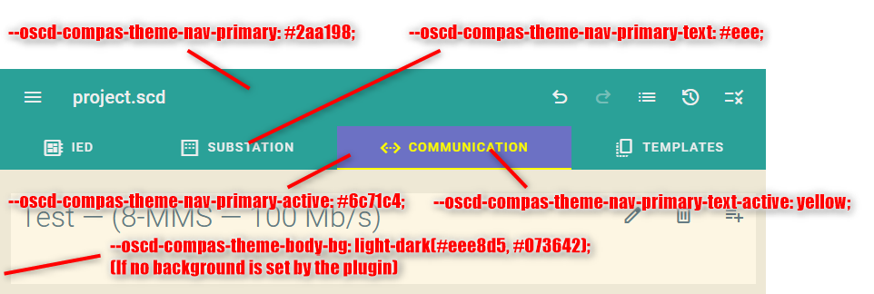

# Customer branding

Brand an OpenSCD or CoMPAS host without changing `themes.ts`.
Set `--oscd-theme-*` in CSS for plugins, and `--oscd-compas-theme-*` for host chrome (app bar, tabs, page background). `--oscd-theme-*` is the portable plugin contract ([plugin-theming.md](./plugin-theming.md)). This host also publishes resolved `--oscd-*` so older plugins keep working; new plugins must not depend on that.

Plugin authors: [plugin-theming.md](./plugin-theming.md).  
Toolbar, plugin-catalog, git modules: [customer-branding-advanced.md](./customer-branding-advanced.md).  

(!) Error and warning are `--oscd-theme-error` / `--oscd-theme-warning`. Success / info are still plugin-defined — [ADR-0006](../decisions/0006-customer-branding-add-status-color-tokens.md).

## Quick start

**This repo (OpenSCD distribution):** edit `packages/distribution/public/css/customer-branding.css`. It is already linked from `packages/distribution/index.html`.

**Distros (like CoMPAS)** consume `@compas-oscd/open-scd` as an npm package. That package does **not** ship `customer-branding.css`. Add your own CSS file (for example `public/css/customer-branding.css`) and a `<link>` in **your** `index.html`. Copy tokens from this repo’s sample file. Do not patch `themes.ts`.

Unset tokens keep the defaults from `themes.ts`.

```css
:root {
  /* Plugin brand fills. Use light-dark() when the color must follow the app theme. */
  --oscd-theme-primary: light-dark(#00695c, #80cbc4);
  --oscd-theme-secondary: #6c71c4;

  /* App bar and editor tabs (host only; plugins must not use these). */
  --oscd-compas-theme-nav-primary: #004d40;
  --oscd-compas-theme-nav-primary-active: #005d50;
  --oscd-compas-theme-nav-primary-text: #eee8d5;
  --oscd-compas-theme-nav-primary-text-active: yellow;

  /* Page background behind the shell (host only). */
  --oscd-compas-theme-body-bg: light-dark(#dff, #001b16);
}
```

Use `light-dark(light, dark)` when a value should follow the app theme setting. Omit it for a color that stays the same in both modes (typical for `--oscd-compas-theme-nav-primary`).

`--oscd-theme-primary` does **not** paint the app bar. That is `--oscd-compas-theme-nav-*`. Unset nav tokens keep OpenSCD cyan. A customer distro may omit these `--oscd-compas-theme-nav-*` tokens or hard-code them.

## Layers

Custom branding fans out to the host and to each plugin. The plugin then maps into its libraries. It is not a pipeline through the host.


| Layer | Tokens | Who |
|---|---|---|
| Custom branding / distro | `--oscd-theme-*`, `--oscd-compas-theme-*` | Distro CSS. `--oscd-theme-*` is the portable plugin contract. `--oscd-compas-theme-*` is host chrome only. |
| Host | `--oscd-*`, `--oscd-internal-*` | Host chrome. Plugins must not depend on these. |
| Plugin | maps `--oscd-theme-*` → library prefixes | Plugin root. |
| oscd-ui | `--oscd-*` (planned rename `--oscd-ui-*`) | Shared OpenSCD UI, including Ace. |
| Google Material lib | `--md-sys-*`, `--mwc-*` | Material components used by the plugin. |
| Others | e.g. `--others-*` | Any other UI stack. |

## Testing

You can test your customer-Branding with the Bearingpoint Demo Theme Plugin: https://ase-compas.github.io/compas-bearingpoint-plugins/plugins/demo-theme/

## `--oscd-theme-*` tokens

| Key | Default | Description | Theme |
|---|---|---|---|
| `--oscd-theme-base03` … `--oscd-theme-base3` | Solarized via `light-dark()` | Plugin-facing Solarized scale. Inverts in dark mode. | Light/Dark |
| `--oscd-theme-yellow` | `#b58900` | Solarized yellow. | Fixed |
| `--oscd-theme-orange` | `#cb4b16` | Solarized orange. | Fixed |
| `--oscd-theme-red` | `#dc322f` | Solarized red. | Fixed |
| `--oscd-theme-magenta` | `#d33682` | Solarized magenta. | Fixed |
| `--oscd-theme-violet` | `#6c71c4` | Solarized violet. | Fixed |
| `--oscd-theme-blue` | `#268bd2` | Solarized blue. | Fixed |
| `--oscd-theme-cyan` | `#2aa198` | Solarized cyan (default primary). | Fixed |
| `--oscd-theme-green` | `#859900` | Solarized green. | Fixed |
| `--oscd-theme-primary` | `--oscd-theme-cyan` | Plugin brand fill. Contrast with `--oscd-theme-base2` / `--oscd-theme-base3`. | Either |
| `--oscd-theme-secondary` | `--oscd-theme-violet` | Second plugin brand fill (landing tiles). Same contrast rule. | Either |
| `--oscd-theme-error` | `--oscd-theme-red` | Error fill. | Fixed |
| `--oscd-theme-warning` | `--oscd-theme-yellow` | Warning fill. | Fixed |
| `--oscd-theme-text-font` | `'Roboto'` | UI text font. | Fixed |
| `--oscd-theme-text-font-mono` | `'Roboto Mono'` | Monospace font. | Fixed |
| `--oscd-theme-icon-font` | `'Material Symbols Outlined'` | Icon font (`--mdc-icon-font` follows this). | Fixed |
| `--oscd-theme-shape` | `8px` | Corner radius (Material **small**). Host-published; plugins map `--md-sys-shape-corner-*` themselves. | Fixed |
| `--oscd-theme-branding` | unset | Optional brand id for plugin `@container style()` fixes. | Fixed |

**Theme column:** *Fixed* = same in light and dark. *Light/Dark* = follows `color-scheme` (usually via `light-dark()`). *Either* = leave fixed when contrast is enough (default cyan); use `light-dark()` when the color is too dark or too light on paper.

Contrast on primary/secondary is `--oscd-theme-base2` or `--oscd-theme-base3`. Keep that in mind when defining primary/secondary for light/dark — see [plugin-theming.md § Contrast](./plugin-theming.md#contrast).

## Host chrome (`--oscd-compas-theme-*`)

These tokens brand the app bar, editor tabs, and the page background. The `compas` segment marks them as host-distribution only, so they are not part of the portable `--oscd-theme-*` plugin contract. Plugins must not read them. The host maps the nav tokens to `--oscd-internal-nav-*`.

| Key | Default | Description | Theme |
|---|---|---|---|
| `--oscd-compas-theme-nav-primary` | `--oscd-theme-cyan` | App-bar / tab fill. | Either |
| `--oscd-compas-theme-nav-primary-active` | `--oscd-theme-cyan` | Active editor-tab fill. | Either |
| `--oscd-compas-theme-nav-primary-text` | `--oscd-theme-base2` | App-bar / tab ink. | Either |
| `--oscd-compas-theme-nav-primary-text-active` | `--oscd-theme-base2` | Active editor-tab indicator. | Either |
| `--oscd-compas-theme-body-bg` | Solarized base2 | Page background behind the app. Independent of `--oscd-theme-base2`. | Light/Dark |



## Solarized palette

Plugins read `--oscd-theme-base03` … `--oscd-theme-base3` plus the accent colors. Defaults follow [Ethan Schoonover’s Solarized](https://ethanschoonover.com/solarized/). Dark mode inverts the base scale (`base3` is the lightest surface in light mode and the darkest in dark mode). Accents stay fixed: they are text colors that remain readable on both light and dark surfaces.

Override `--oscd-theme-base03` … `--oscd-theme-base3` and `--oscd-theme-yellow` … `--oscd-theme-green` when Solarized clashes with the corporate color.

## Fonts

`--oscd-theme-text-font` (default `'Roboto'`), `--oscd-theme-text-font-mono` (default `'Roboto Mono'`), and `--oscd-theme-icon-font` (default `'Material Symbols Outlined'`). Load the font files from `public/` (or your fork’s static folder) if you change them. This host already ships Roboto, Roboto Mono, Material Icons Outlined, and Material Symbols Outlined.

## Marker property

`--oscd-theme-branding` is an optional id (no spaces), for example `Bearingpoint`. Plugin authors can ship brand-specific CSS **before** the host is upgraded:

```css
@container style(--oscd-theme-branding: Bearingpoint) {
  /* temporary host fixes */
}
```

Leave it unset on stock OpenSCD.

## Light / dark / system

Settings is a select: **System default** (OpenSCD default), **Light**, **Dark**. `themes.ts` sets `color-scheme` on `<html>` (`light`, `dark`, or `light dark` for system). CSS `light-dark(light, dark)` then follows that:

```css
--oscd-compas-theme-body-bg: light-dark(#ffffff, #000000);
```

Omit `light-dark()` for a value that must stay the same in both modes.

System default is required so distributions that brand with `prefers-color-scheme` (and hide the in-app toggle) keep following the OS.

## `color-mix`

For extra steps on the Solarized ramp (or a darker body in dark mode), mix existing tokens instead of inventing new hexes:

```css
color-mix(in oklab, var(--oscd-theme-base03) 50%, #000)
```

## What not to do

Do **not** set component-library variables (`--mdc-*`, `--md-sys-*`, `--md-*`). Each plugin may use a different library or version. Those mappings in `themes.ts` exist only for compatibility and may go away. Plugins must configure their own component library.

Do **not** set `--oscd-*` or `--oscd-internal-*` here. The host maps `--oscd-theme-*` → `--oscd-*` for its surfaces and for older plugins. App bar and tabs read `--oscd-compas-theme-nav-*` into `--oscd-internal-nav-*`. New plugins map `--oscd-theme-*` themselves. `--oscd-internal-*` and `--oscd-compas-theme-*` are host chrome.

More (plugin catalog, git modules, toolbar/logo): [customer-branding-advanced.md](./customer-branding-advanced.md).
